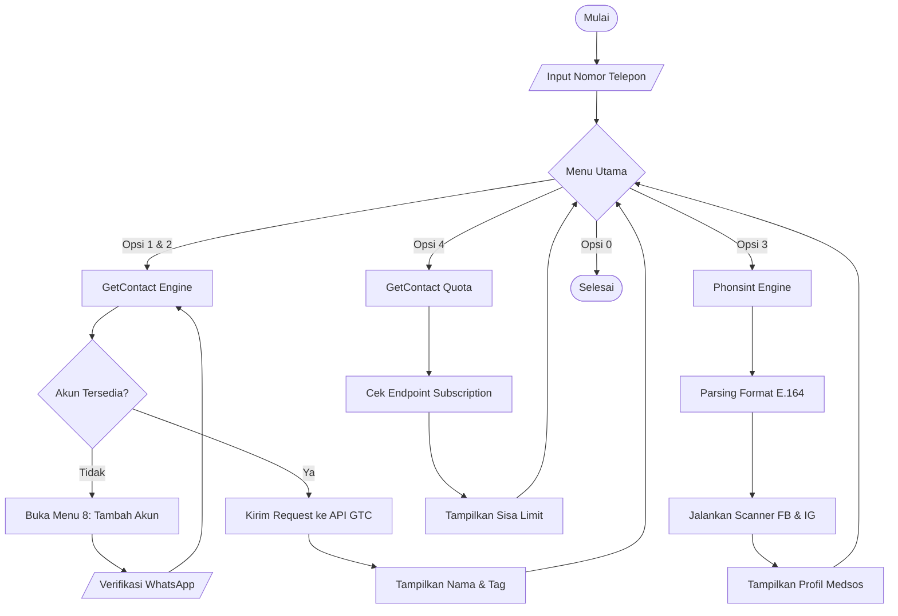

<div align="center">
  

<p align="center">
  
  
  
</p>

<p align="center">
  <i>Alat OSINT mencari nama pengguna dan akun pengguna dari nomor telepon</i>
</p>

</div>

---

## ✨ Fitur Utama

- 🔍 **GetContact Integration** — Cari nama pemilik nomor dan tag (nama yang disimpan orang lain).
- 📱 **Social Media Scan** — Cek apakah nomor terdaftar di Facebook dan Instagram menggunakan engine Phonsint.
- 📊 **Quota Tracker** — Pantau sisa kuota akun GetContact kamu.
- 🚀 **Batch Processing** — Cek banyak nomor sekaligus dari file CSV.

---

## 🛠️ Instalasi

**1. Clone repositori ini**
```bash
git clone https://github.com/hirumisann/OsintSaku.git
cd OsintSaku
```

**2. Instal dependensi**
Pastikan Python 3.10+ sudah terinstal, lalu jalankan:
```bash
pip install requests cryptography colorama curl_cffi phonenumbers rich dnspython
```

**3. Jalankan program**
```bash
python osintsaku.py
```

---

## 📸 Cara Pakai

Saat program berjalan, kamu akan disuguhi menu interaktif:

```text
  ════════════════════════════════════════════════
    ✦  PILIH FITUR  ✦
  ════════════════════════════════════════════════
  [1] Cari profil nomor  Nama pemilik
  [2] Cari tag nomor  Nama tersimpan orang lain
  [3] Pindai medsos (IG/FB)  Cek akun terdaftar
  [4] Sisa kuota akun  Cek limit harian
  [5] Cari banyak nomor dari CSV  Batch lookup
  [6] Buka blokir / captcha  Verifikasi manual
  [7] Lihat akun tersimpan  Daftar kredensial
  [8] Tambah akun baru  Butuh WhatsApp
  [0] Keluar
  ════════════════════════════════════════════════
```

- **Untuk GetContact (Menu 1, 2, 4, dst):** Kamu diwajibkan membuat kredensial (akun) terlebih dahulu di menu `[8] Tambah akun baru`. Kamu akan diminta verifikasi via WhatsApp.
- **Untuk Scan Medsos (Menu 3):** Kamu tidak perlu login. Cukup masukkan nomor target (contoh: `+6285861060096`).

---

## 🔄 Alur Kerja (Flowchart)

Berikut adalah gambaran bagaimana OsintSaku memproses data di balik layar:



---

## ⚠️ Disclaimer

> **Alat ini dibuat hanya untuk tujuan edukasi dan pengujian keamanan pribadi.** 
> Penggunaan alat ini untuk melacak, mengintimidasi, atau merugikan orang lain adalah tindakan ilegal dan melanggar privasi. Segala penyalahgunaan adalah tanggung jawab pengguna sepenuhnya.

---

<div align="center">

**[Akun Medsos Ku]**

<p>
  <a href="https://instagram.com/hirumisann">
</p>

</div>
